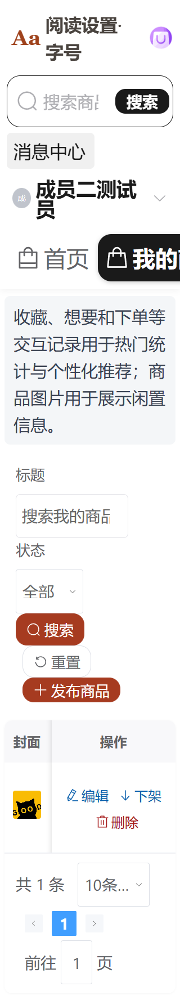
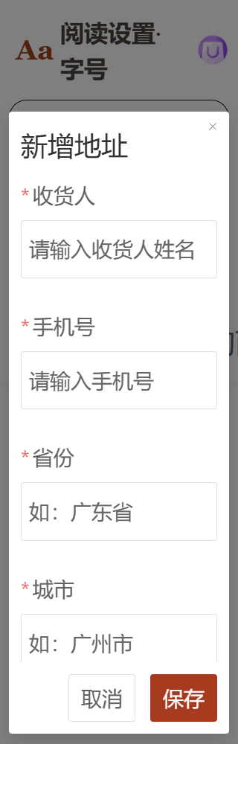
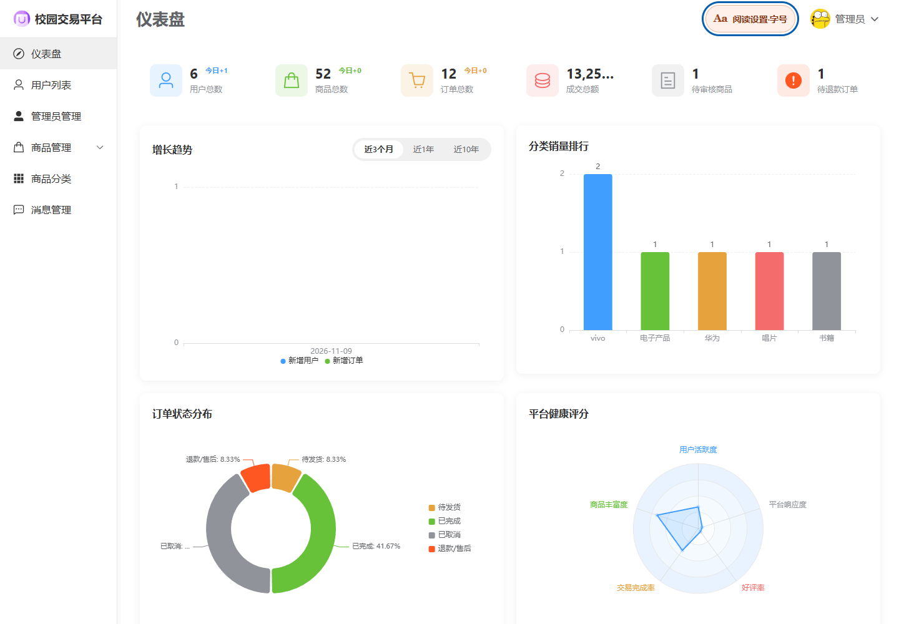
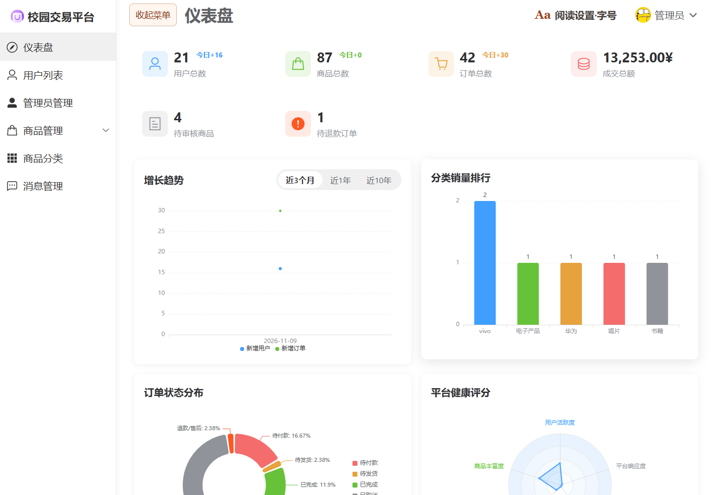
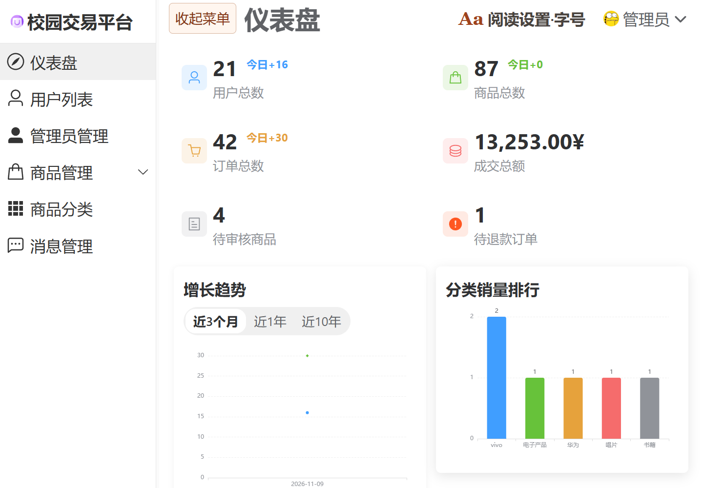
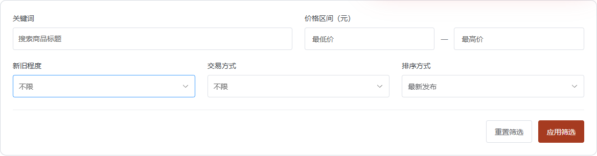
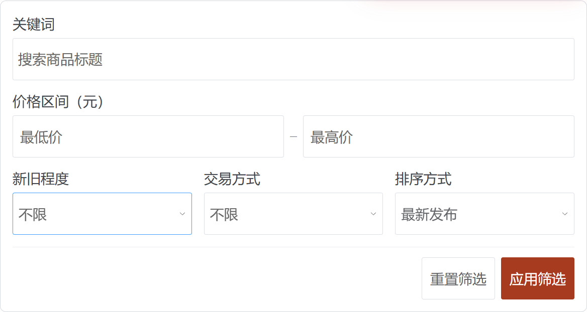

# 全站字号与基础无障碍适配：测试用例及记录

测试日期：2026-11-09（Asia/Shanghai）。分支：`codex/test-player-2`。

项目目录：`D:\ProgrammeProject\campus-system-vue3\campus-system-dev`。

访问入口：<http://127.0.0.1:21091/>。后端：21090；数据库：`campus_system_dev_test`。本次仅修改前端，不涉及数据库结构变更。

## 修改内容

统一入口名称为“阅读设置·字号”，包含标准 100%、大字 125%、特大字 150%、超大字 200% 和恢复默认。设置即时生效、保存在当前浏览器，并支持跨标签页同步；旧商品大字开关开启状态迁移为 125%。登录、注册页入口位于背景区左上角，游客和用户端融入导航左侧，管理员端融入顶部头像左侧，不再独立占用整条灰色横栏。

桌面标准/大字使用按钮下方的轻量面板；窄屏或 150%/200% 字号使用居中对话框，支持 Escape 和关闭后焦点恢复。登录、注册页始终保留背景图片和品牌；空间不足时切换为上图下表单，减少装饰文字，不隐藏背景。背景加深遮罩以保证文字对比度。

页面文字采用随根字号变化的相对单位；共享组件、弹窗、下拉菜单和分页一同适配。放大时导航换行、商品列表调整列数、表单改为纵向排列，避免固定高度截字。数据表格在窄屏保留内部横向滚动，不通过隐藏数据列适配。

登录注册新增可见字段标签和表单内错误提示；增加跳过导航入口、键盘焦点样式、点击元素的键盘支持、部分遗漏按钮/输入框的可读名称、头像替代文字，并支持系统减少动态效果。轮播停止自动切换，改为用户主动选择。

## 已执行的验证

- Node 24.22.1；前端类型检查及生产构建通过。
- 单元测试：12 项通过（字号存储/迁移/容错 5 项，原商品体验回归 7 项）。
- Edge 无界面浏览器 + Playwright + axe-core：验证 4 档字号的实际计算值、刷新/跨页保持、注册空表单提示、键盘设置操作和恢复默认。
- 200% 字号下，1440、768、320 CSS 像素宽度分别测试登录、注册、市场、我的商品、订单、地址和聊天，共 21 个页面/宽度组合。
- 这 21 个组合均无页面级横向溢出，所用 axe WCAG A/AA 规则扫描未检出违规；另检查新增地址弹窗与关闭后焦点恢复。
- 证据见 [浏览器结果 JSON](accessibility-evidence/results.json) 及下方截图。扫描仅覆盖实际打开的页面和状态，不能代替人工读屏或完整 WCAG 合规评估。
- 新增登录注册背景与入口专项验证：4 个宽度（1440/1024/768/320）× 4 档字号 × 2 个页面，共 32 组合，检查背景存在、无页面溢出、入口不遮挡品牌和上下排列规则；管理员顶部入口另测 4 组合，合计 36 项通过。见 [布局专项结果](accessibility-evidence/reading-layout-results.json)。
- 导航专项：游客/用户 × 5 种宽度（1920/1440/1024/768/320）× 4 档字号，共 40 组合通过；检查顶部各区块不重叠、宽屏顶部单行、用户菜单单行、实际滚动后导航吸顶以及焦点避让高度同步。见 [导航专项结果](accessibility-evidence/navigation-results.json)。

## 可供老师复核的用例

“自动通过”表示本次脚本已验证；“待人工复核”保留给实际操作人员记录，不作为已经通过。

| 编号 | 测试内容与步骤 | 预期结果 | 本次记录 |
|---|---|---|---|
| A01 | 登录页打开无障碍设置，依次选择四档 | 当前比例正确，账号输入文字按比例放大 | 自动通过 |
| A02 | 选择 200%，刷新，再进入注册页 | 仍为 200%，页面文字一致放大 | 自动通过 |
| A03 | 展开设置，点击恢复默认 | 恢复 100%，后续页面采用默认 | 自动通过 |
| A04 | 浏览器仅存在旧键 `product-large-text=true` | 自动采用 125% | 单元通过 |
| A05 | 存储值写入非法比例 | 回退为 100%，不出现极小或无限大字体 | 单元通过 |
| A06 | 模拟浏览器禁止读取/写入存储 | 当前会话仍可调节和恢复字号 | 单元通过 |
| A07 | 两个同源标签页，一页修改字号 | 另一页同步更新，不形成循环事件 | 待人工复核 |
| A08 | 未登录进入登录/注册页 | 账号、密码、昵称均有可见标签和关联名称 | 页面扫描通过；读屏待复核 |
| A09 | 注册页空表单提交 | 显示可见错误，提示区域具有 alert 语义 | 自动通过 |
| A10 | 页面载入后按 Tab、Tab、Enter | 先到“跳到主要内容”，再到设置按钮并打开 | 自动通过 |
| A11 | 用键盘操作字号单选组 | 可选择四档，焦点清晰，读屏可知当前选中项 | 待人工复核 |
| A12 | 用测试用户进入市场、我的商品等页面 | 顶部导航、首页、我的商品、输入框和按钮共同放大 | 200% 页面扫描通过；视觉待复核 |
| A13 | 上述 7 页分别使用 1440/768/320 宽度及 200% 字号 | 页面无横向溢出，控件可访问 | 自动通过，共 21 组合 |
| A14 | 我的商品在窄屏查看表格，横向滚动 | 可以查看标题、价格、状态和操作，操作列不遮挡内容 | 截图检查；操作待复核 |
| A15 | 200% 下打开新增地址弹窗，按 Escape | 弹窗可打开/关闭，焦点回到新增按钮 | 自动通过 |
| A16 | 打开商品发布、编辑、地址等表单弹窗 | 标签、输入、下拉选项、错误提示均放大且不截字 | 地址扫描通过；其余状态待人工复核 |
| A17 | 管理员在四档字号下进入各菜单、展开分组 | 侧栏、面包屑、表格和对话框均可阅读操作 | 待人工复核 |
| A18 | 游客市场、商品详情、收藏、下单和评价逐页测试 | 字号继承；详情和操作按钮完整可见 | 待人工复核 |
| A19 | 站内 100% 字号时，将浏览器缩放到 200%/400% | 内容合理重排，主要流程可完成，无遮挡 | 待人工复核 |
| A20 | Windows 启用减少动画，浏览市场和弹窗 | 动画减弱；轮播不自动切换 | CSS 已实现；系统实机待复核 |
| A21 | NVDA/其他读屏软件完成登录、筛选、发布 | 标签、按钮名称和错误可理解，焦点顺序合理 | 待人工复核 |
| A22 | 仅键盘完成登录、导航、筛选、打开/关闭弹窗 | 无键盘陷阱、焦点可见且能返回触发按钮 | 设置和地址弹窗自动通过；完整流程待复核 |
| A23 | 发布商品、收藏、订单等原有操作回归 | 无障碍调整不影响业务结果 | 商品体验 7 项自动回归通过；业务人工待复核 |
| A24 | 断开网络触发错误、再恢复并重试 | 反馈可见可读、原内容不丢失 | 商品列表重试逻辑单元通过；页面待复核 |
| A25 | 用户点击退出登录；分别在 1440/320 宽度、100%/200% 字号检查 | 确认框水平和垂直居中，宽度不超过 440px，并留有屏幕边距 | 自动通过，共 4 组合 |
| A26 | 在退出确认框点击取消 | 弹窗关闭，保留登录状态 | 自动通过；管理员分支待人工复核 |
| A27 | 登录/注册在四种宽度及四档字号下查看背景与品牌 | 背景始终保留，入口不遮挡品牌，空间不足上下排列 | 专项自动通过，32 组合 |
| A28 | 管理员在 1440/320 宽度、100%/200% 字号打开阅读入口 | 入口仅出现一次，位于顶部头像左侧；面板不越界；Escape 关闭后焦点返回 | 专项自动通过，4 组合 |
| A29 | 桌面打开阅读设置后调至 150%/200%，再恢复默认 | 自动从轻量面板切换为对话框，字号选项仍可操作 | 四档字号浏览器回归通过 |
| A30 | 游客/用户在五种宽度、四档字号下检查顶部导航 | 分区不重叠；宽屏顶部同一行；用户六个菜单同一行，窄屏可横向滚动 | 导航专项通过，共 40 组合 |
| A31 | 上述各组合实际向下滚动 600px | 导航仍在视口顶部；高度不超过视口 60%；焦点避让变量与导航实际高度一致 | 导航专项通过，共 40 组合 |
| A32 | 管理员仪表盘、用户、商品、分类页，四档字号与 1440/1024/768/320 宽度逐一切换 | 左侧菜单与右侧内容始终左右排列；内容区域在视口内、可滚动，页面不横向溢出；仪表盘统计数值不截断 | 自动通过，64 组合 |
| A33 | 上述每页/宽度在 200% 下收起再展开菜单 | 右侧仍保持可视；操作有明确按钮；侧栏宽度按字号适配且有上限 | 自动通过，16 组收起/展开往返 |
| A34 | 游客/用户商品市场在 1440/1024/768/320 宽度及四档字号下检查筛选区 | 标签位于控件上方且左对齐；控件等高；按钮独立底行；表单不溢出；所测表单无自动无障碍扫描违规 | 自动通过，32 组合（2026-11-10） |
| A35 | 输入关键词及 10—20 元价格范围并应用；将最低价改成 50；最后重置 | 请求使用去除首尾空白的关键词与正确价格；错误区间提示；重置清空条件和错误并恢复最新发布 | 自动通过，1 组组合交互（2026-11-10） |
| A36 | 管理员在四种宽度、四档字号下分别展开/关闭商品子菜单，再收起/展开侧栏 | 收起后六个一级图标行等高、连续且无隐藏子菜单占位；重新展开保留子菜单状态 | 自动通过，16 组合、32 次往返 |
| A37 | 开启正常动画偏好，逐帧记录侧栏重新展开后的标题位置、尺寸及侧栏宽度 | 从第一个渲染帧起布局稳定，没有先换行再向上跳动 | 自动通过，32 次展开，每次连续 18 帧 |
| A38 | 收起状态通过 Enter 打开商品管理浮层、Esc 关闭，再用鼠标/方向键及 Enter 进入三个子页面 | 浮层完整可见；Esc 关闭并返回触发按钮；商品、订单、评价页面均可进入 | 自动通过，16 组合、48 次子页面导航 |

人工验收记录：测试人员 ________；浏览器/版本 ________；日期 ________；通过用例 ________；问题及截图编号 ________。

## 复现命令

在开发副本 `view` 目录：

```powershell
$env:PATH = 'D:\javasoft\nvm\installs\v24.22.1;' + $env:PATH
node --test tests/accessibility.test.cjs tests/product-experience.test.cjs
npm.cmd run build
```

浏览器检查需前后端已启动。在开发副本根目录执行（测试工具独立安装于 Git 忽略目录，不更改业务依赖）：

```powershell
$env:PATH = 'D:\javasoft\nvm\installs\v24.22.1;' + $env:PATH
npm.cmd install --prefix .local-backups/a11y-tools --no-save --package-lock=false playwright @axe-core/playwright
node view/tests/accessibility-browser.cjs
node view/tests/reading-layout-browser.cjs
node view/tests/navigation-browser.cjs
node view/tests/admin-layout-browser.cjs
node view/tests/product-filters-browser.cjs
node view/tests/admin-sidebar-browser.cjs
```

需要已安装 Microsoft Edge，以及独立测试库中的 `player2_tester` 测试账号（此前导入阶段创建）。脚本不注册新账号、不提交表单数据，仅登录、读取页面、检查空表单和打开/关闭地址弹窗。结果写入 `.local-backups/accessibility-results/`。人工测试发布/修改会改变测试库，请勿连接原库。

布局专项脚本额外使用仓库初始化 SQL 中的测试管理员凭据登录，只在内存中读取凭据、不输出密码、不写入数据库。专项结果写入 `.local-backups/reading-layout-results/`。

导航专项结果写入 `.local-backups/navigation-results/`。所有字号恢复吸顶；窄屏按固定网格分行，菜单单行横向滚动。导航整体在矮屏上限制为视口高度的 60%，超出部分可在导航内滚动，避免挡住全部正文。阅读入口标准字号为 16px。

管理端布局专项结果写入 `.local-backups/admin-layout-results/`，只登录和读取测试库页面，不新增或修改业务记录。修复了大字号将侧栏强制设为全宽、主布局换行导致右侧内容离开视口的问题；保留标准左右布局，侧栏和内容分别滚动，大字号侧栏宽度适度增加但不超过 320px 和可用宽度上限。窄屏初始收起侧栏，顶部按钮可明确收起/展开菜单。

## 截图证据

### 登录页，320 宽度，200%


### 我的商品，320 宽度，200%



### 地址弹窗，320 宽度，200%



### 登录页保留背景，桌面 200%


### 管理员顶部入口，标准字号



### 用户导航，1440 宽度，200% 字号，向下滚动后仍吸顶


### 管理员左右布局，大字 125% / 超大字 200%

[管理端专项原始结果](accessibility-evidence/admin-layout-results.json)





### 商品筛选布局更新（2026-11-10）

关键词和价格区间组成第一组，新旧程度、交易方式、排序方式组成第二组。标签统一置顶，最低/最高价格保留独立可读名称，重置与应用按钮独立放在底部。根据筛选卡片实际可用宽度及字号改变列数，极窄时价格输入也纵向排列。

构建通过；[33 项布局及交互检查结果](accessibility-evidence/product-filters-results.json)。本次为前端筛选区增量更新，不涉及数据库结构或业务数据变更。

补充修复：筛选下拉框内部行高改为随字号变化的 1.5 倍，内部输入高度随内容增长，外框保留一致的最小高度。四档字号下检查选中值文字实际边界没有超出裁切区域，并检查展开选项的行高与可见高度；33 项复测及构建通过。





### 管理员侧栏更新（2026-11-10）

收起侧栏后，商品子菜单退出页面布局，六个一级菜单图标连续排列；商品管理通过右侧浮层提供商品列表、订单管理和评价管理入口。重新展开保留原子菜单状态。取消侧栏宽度、标题区域及菜单间距的布局动画，保留悬停颜色和展开箭头效果。

[侧栏专项结果](accessibility-evidence/admin-sidebar-results.json)：四种宽度 × 四档字号共 16 组合通过，覆盖状态保留、正常动画偏好下逐帧稳定性、浮层范围、Esc 焦点返回及鼠标/键盘导航。管理员原有 64 组页面布局及 16 次侧栏往返回归通过；类型检查和生产构建通过。本次为管理员侧栏交互与布局更新，不涉及数据库结构或业务数据变更。


## 检查边界

已完成共享字号机制与页面样式适配；管理员复杂表格、所有商品表单状态、真实辅助技术、浏览器原生缩放及完整业务链路仍需按上表人工验收。未声明全站已通过 WCAG 认证，也未将待复核项记为通过。

参考：[W3C 文字缩放](https://www.w3.org/WAI/WCAG22/Understanding/resize-text.html)、[内容重排](https://www.w3.org/WAI/WCAG22/Understanding/reflow.html)。
